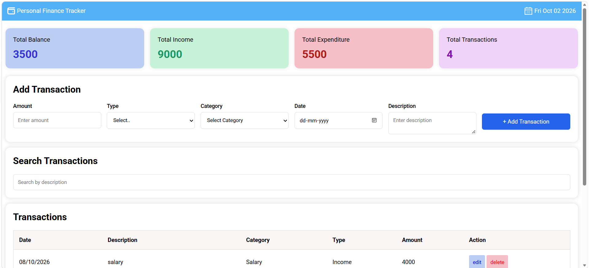
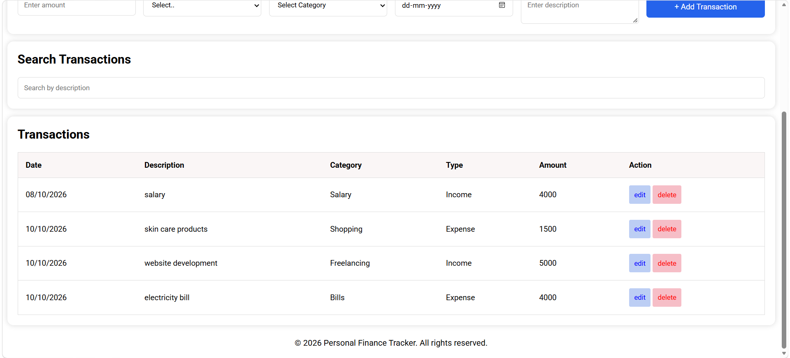
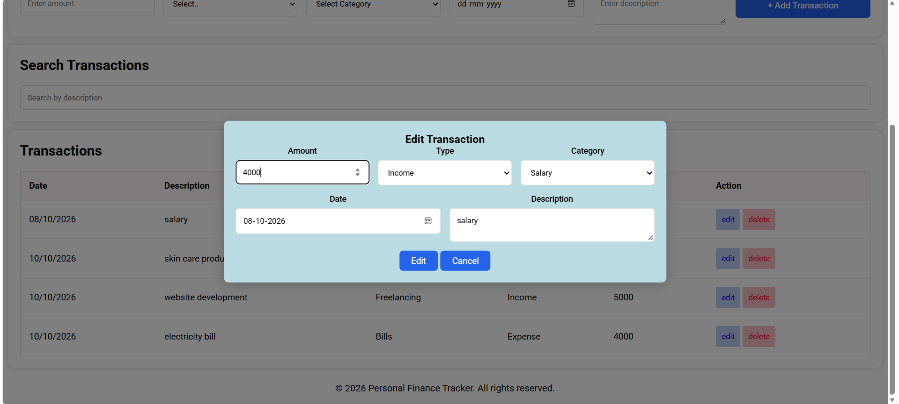

# Personal Finance Tracker

A responsive personal finance tracker built with HTML, CSS, and JavaScript.  
The application allows users to manage income and expense transactions and keeps data saved using the browser's Local Storage.

## Features

- Add income and expense transactions
- Edit existing transactions
- Delete transactions with confirmation
- Search transactions by description
- Automatically calculate total balance
- Display total income and expenses
- Display total number of transactions
- Store transaction data using Local Storage
- Custom alert and confirmation dialogs
- Responsive layout for different screen sizes

## Screenshots

### Dashboard Overview

### Transactions

### Edit Transaction

## Technologies Used

- HTML5
- CSS3
- JavaScript (ES6+)
- Browser Local Storage
- Responsive Web Design

## How It Works

Users can add financial transactions by entering the amount, type, category, date, and description.

The dashboard automatically calculates:

- Total Balance
- Total Income
- Total Expenses
- Total Transactions

Transactions can also be searched, edited, or deleted.

All transaction data is stored in the browser using Local Storage, allowing the data to remain available after refreshing the page.
